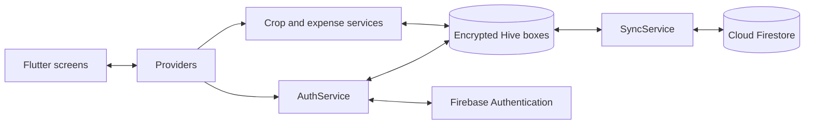

# 🌾 FarmApp

A comprehensive **offline-first** farm management application built with Flutter. Track your crops from planting to harvest, manage expenses, record sales income, and keep your finances organized — all with or without an internet connection.

---

## ✨ Features

### 🌱 Crop Management
- Track crops through their full lifecycle: **Planning → Planted → Growing → Harvested → Sold / Consumed**
- Record planting and harvest dates
- Log sale amounts and estimated consumption values
- View detailed crop information with expense breakdowns

### 💰 Finance & Expense Tracking
- **Crop-specific expenses** — Track costs tied to individual crops (seeds, fertilizer, labor, etc.)
- **Common expenses** — Record farm-wide expenses not linked to a specific crop (equipment, utilities, etc.)
- **Income tracking** — Record a sale amount or an estimated consumption value on the crop
- **Profit calculation** — See income vs. expenses at a glance

### 📊 Dashboard
- At-a-glance overview of total crops, active (growing) crops, and total expenses
- Quick action shortcuts for adding crops, recording expenses, and viewing finances
- Personalized greeting with user information

### 🔐 Offline-First Authentication
- **Registration** requires internet (creates accounts on both Firebase Auth and local Hive storage)
- **Login** works fully offline using locally stored, hashed credentials
- Passwords are salted and hashed with **SHA-256** before local storage
- Session persistence across app restarts

### ☁️ Cloud Sync (Optional)
- **Bidirectional sync** between local Hive storage and Cloud Firestore
- Toggle automatic sync from Settings
- Crop conflicts use `updatedAt` to choose the newer version
- Sync status tracking per record (`pending`, `synced`, `modified`, `deleted`)
- Manual "Sync Now" with detailed push/pull/conflict reporting
- Initial download when syncing an account with no local crop records

### 🔒 Security
- Hive boxes use **AES-256** encryption, with the key managed by `flutter_secure_storage`
- Firestore rules restrict farm data to the signed-in account and validate fields on selected document creates

---

## 🏗️ Backend Architecture

### Offline-First Design



The Flutter app talks directly to Firebase Authentication and Cloud Firestore. Crop and expense services write to Hive first, and providers listen for local changes to update the screens. `SyncService` copies changes between Hive and Firestore. [App startup](lib/main.dart) · [Sync service](lib/core/services/sync_service.dart)

### Local storage in Hive

On native platforms, Hive stores its box files in the app's documents directory. On the web, Hive uses IndexedDB. `HiveService` opens all seven boxes with `HiveAesCipher`, using a generated key that it stores and retrieves through `flutter_secure_storage`. Crop and expense records are stored as maps with dates encoded as ISO 8601 strings. [Hive service](lib/core/services/hive_service.dart) · [Crop model](lib/models/crop_model.dart) · [Expense model](lib/models/expense_model.dart)

| Hive box | Key | Stored data |
|---|---|---|
| `users` | Normalized email | Local account ID, linked Firebase UID, and salted SHA-256 password hash |
| `crops` | `{localUserId}_{cropId}` | Crop name, status, planting and harvest dates, sale amount or consumption value, archive fields, and sync metadata |
| `expenses` | `{localUserId}_{cropId}_{expenseId}` | Crop expense title, amount, date, and sync metadata |
| `common_expenses` | `{localUserId}_common_{expenseId}` | Farm-wide expenses |
| `crop_history` | `{localUserId}_{cropId}` | Archived crop snapshots |
| `expense_history` | `{localUserId}_{cropId}_{expenseId}` | Copies of a crop's expenses at the time of archiving |
| `common_expense_history` | `{localUserId}_common_{expenseId}` | Archived farm-wide expenses |
| `settings` | Setting name | Sync preference, last sync time, and the email used to restore the local session |

The app creates a local account ID on each device and links it to the same Firebase Auth UID. Crops and expenses have a stable `localId` that the sync service sends to Firestore and uses to match records across devices. `firebaseId` records the corresponding Firestore document ID in Hive after upload or download. The crop ID in a Hive key normally uses the local crop ID. The initial download can key nested expenses by the Firestore crop document ID. [Local user model](lib/models/user_model.dart) · [Sync service](lib/core/services/sync_service.dart)

When a user removes a sold or consumed crop from **My Crops**, the app copies its expenses and crop snapshot into the history boxes and flags the original crop as archived. Both lists observe the crop and history boxes. A history snapshot hides the crop from My Crops even if a stale row still exists in `crops`. History shows one entry per crop key. [Crop service](lib/features/crops/services/crop_service.dart)

To archive a farm-wide expense, long-press it in **Finance → Common Expenses** and select **Move to History**. **History → Expenses** lists archived common expenses and crop expenses grouped by crop. The **All-Time Summary** combines current and archived expenses, counting each expense once.

Use **History → Clear History → Clear on all devices** to delete archives while keeping current crop and expense records. The app saves the request in Hive before clearing this device. **Cloud deletion pending** stays visible until Firebase confirms the deletion after sync resumes. The `history/archive` document now records the clear cutoff so older archives cannot be uploaded again. Publish the updated Firestore rules to enable this feature.

Use **Settings → Reset Farm Data** while signed in, online, and with cloud sync enabled. Type `RESET` to delete all current and archived farm records while keeping the account, profile, and app settings. If the connection is interrupted, open the same action again to finish the reset. Other devices clear their previous farm data before syncing again.

Deploy the updated Firestore rules before using the reset in production. FarmApp deletes the signed-in user's records directly in Firestore batches, including expenses whose parent crops were previously deleted. The reset works on the Firebase Spark plan within Firestore's quotas. Update all devices to a version that supports farm resets so they can sync afterward.

```powershell
firebase deploy --only firestore:rules --project farm-project
```

The `users/{firebaseUid}/operations/farm_reset` marker identifies the reset across devices. While it is running, Firestore rules allow deletion batches for that reset and block ordinary farm writes. When all batches have finished, the app marks the reset complete and clears Hive farm records. Other devices apply the new farm generation before they upload pending edits. Run the rules regression test with the Firebase emulators.

```powershell
firebase emulators:exec --project demo-farm-reset --only auth,firestore "node --test test/firestore_reset.test.cjs"
```

### Authentication and Firestore storage

Firebase Authentication handles registration and first sign-in on a device. On later sign-ins, the app can verify the password against its local salted hash while offline. Hive keeps the hash, salt, and Firebase UID in `users`, and the `settings` box lets the app restore the session when it restarts. [Auth service](lib/features/auth/services/auth_service.dart)

`SyncService` stores cloud documents under `users/{firebaseUid}`, where `firebaseUid` is the Firebase Authentication account ID. Firestore stores dates as `Timestamp` values and uses its document IDs in collection paths. [Sync service](lib/core/services/sync_service.dart)

```text
users/{firebaseUid}
├── crops/{cropDocumentId}
│   └── expenses/{expenseDocumentId}
├── common_expenses/{expenseDocumentId}
├── crop_history/{legacyHistoryId}
└── history/archive
    ├── crops_history/{cropId}
    │   └── expenses_history/{expenseId}
    └── common_expenses_history/{expenseId}
```

Sale amounts and estimated consumption values live on crop documents. Crop and expense snapshots sync under `history/archive`. The app still reads the legacy `crop_history` collection and copies those snapshots into the new structure during sync. Original crop expenses remain linked to their source crop and are excluded from current lists once it is archived. For common expenses, Firestore writes the archive copy and deletes the current document in one batch. [Sync service](lib/core/services/sync_service.dart)

### How sync runs

1. A new crop or expense is saved to Hive as `pending`, and the UI can display it immediately. The app records edits as `modified`. Deleting a record with a cloud ID marks it `deleted` so a later sync can remove its Firestore document. The app can delete a record with no cloud ID locally right away.
2. With sync off, Hive updates the tabs and totals as soon as a change is saved. With sync on and a linked Firebase session, Firestore listeners watch current and archived records. Local changes, pull-to-refresh, and **Settings → Sync Now** can also start a sync.
3. With connectivity and a linked account, the service processes crops and their expenses, common expense archives and current common expenses, then crop archives and their expense snapshots. It uploads local changes and pulls remote records into Hive. Once a queued delete succeeds in Firestore, the service removes the local record.
4. For conflicting crop edits, sync compares `updatedAt` and keeps the newer crop, with the local edit winning a tie. For crop and expense pulls, a newer remote row can update a local copy already marked `synced`. Sync errors appear in Settings. [Sync service](lib/core/services/sync_service.dart) · [Settings provider](lib/features/settings/providers/settings_provider.dart)

### Firestore access and current limits

- The checked-in rules allow users to access their documents under `users/{firebaseUid}` when `request.auth.uid` matches that path. Publish the updated `firestore.rules` before using cloud expense history. From the project root, run `firebase deploy --only firestore:rules --project farm-project`. The app writes the history documents when it syncs. [Firestore rules](firestore.rules)
- The account deletion flow attempts to remove the Firebase Authentication account and clears local Hive data. The separate Firestore cleanup method is unconnected to that flow, so cloud farm documents can remain. [Auth service](lib/features/auth/services/auth_service.dart) · [Firestore cleanup method](lib/core/services/sync_service.dart)

### Project Structure

```
lib/
├── main.dart                      # App entry point, provider setup
├── firebase_options.dart          # Firebase configuration
│
├── core/
│   ├── services/
│   │   ├── hive_service.dart      # Encrypted Hive box management
│   │   └── sync_service.dart      # Bidirectional Hive ↔ Firestore sync
│   ├── theme/
│   │   ├── app_colors.dart        # Color palette & gradients
│   │   └── app_theme.dart         # Material theme configuration
│   └── widgets/
│       ├── custom_button.dart     # Reusable styled button
│       ├── custom_text_field.dart # Reusable styled text field
│       ├── loading_overlay.dart   # Full-screen loading indicator
│       └── main_navigation.dart   # Bottom navigation shell
│
├── features/
│   ├── auth/
│   │   ├── providers/             # AuthProvider (ChangeNotifier)
│   │   ├── screens/               # LoginScreen, RegisterScreen
│   │   └── services/              # AuthService (offline-first auth)
│   ├── crops/
│   │   ├── providers/             # CropProvider
│   │   ├── screens/               # AddCropScreen, CropDetailScreen
│   │   └── services/              # CropService
│   ├── finance/
│   │   ├── providers/             # FinanceProvider
│   │   ├── screens/               # FinanceScreen, AddExpenseScreen, ExpenseListScreen
│   │   └── services/              # ExpenseService
│   ├── history/
│   │   ├── providers/             # HistoryProvider
│   │   └── screens/               # HistoryScreen
│   ├── home/
│   │   ├── providers/             # DashboardProvider
│   │   └── screens/               # HomeScreen (dashboard)
│   └── settings/
│       ├── providers/             # SettingsProvider
│       ├── screens/               # SettingsScreen
│       └── services/              # SettingsService
│
├── models/
│   ├── crop_model.dart            # Crop entity with lifecycle statuses
│   ├── expense_model.dart         # Expense entity (crop-specific & common)
│   ├── sale_model.dart            # Sale model outside the current storage flow
│   └── user_model.dart            # LocalUser entity
│
└── routes/
    └── app_routes.dart            # Named route constants
```

### State Management

The app uses **Provider** (`ChangeNotifierProvider`) for reactive state management.

| Provider | Responsibility |
|---|---|
| `AuthProvider` | Login, registration, session management |
| `CropProvider` | CRUD operations for crops |
| `FinanceProvider` | Expenses, crop income, and financial summaries |
| `HistoryProvider` | Archived crops and all-time financial totals |
| `DashboardProvider` | Aggregated dashboard statistics |
| `SettingsProvider` | Sync toggle, sync execution, app preferences |

---

## 🛠️ Tech Stack

| Category | Technology |
|---|---|
| Framework | Flutter 3.50+ (Dart 3.14+) |
| State Management | Provider |
| Local Database | Hive (AES-256 encrypted) |
| Cloud Backend | Firebase (Auth + Cloud Firestore) |
| Secure Storage | flutter_secure_storage |
| Connectivity | connectivity_plus |
| Cryptography | crypto (SHA-256) |
| Unique IDs | uuid (v4) |
| Date Formatting | intl |
| Typography | Google Fonts |

---

## 🚀 Getting Started

### Prerequisites

- **Flutter SDK** 3.50 or later, with Dart 3.14 or later bundled
- **Android** JDK 17 or later and Android SDK Platform 36. The first build can download the required NDK and CMake packages.
- **Windows** Enable Developer Mode if Flutter reports that plugin symlinks require it.
- **Firebase project** configured (Android/Web)
- Android Studio / VS Code with Flutter extension

### Installation

1. **Clone the repository**
   ```bash
   git clone https://github.com/your-username/farm_app.git
   cd farm_app
   ```

2. **Install dependencies**
   ```bash
   flutter pub get
   ```

3. **Configure Firebase**

   This project uses Firebase for authentication and optional cloud sync. You need to set up your own Firebase project:

   ```bash
   # Install FlutterFire CLI if you haven't
   dart pub global activate flutterfire_cli

   # Configure Firebase for your project
   flutterfire configure
   ```

   This generates `lib/firebase_options.dart` with your project's configuration. The Android build also requires `android/app/google-services.json` for the configured Android app.

4. **Deploy Firestore rules** (if using cloud sync)
   ```bash
   firebase deploy --only firestore:rules,firestore:indexes
   ```

5. **Run the app**
   ```bash
   flutter run
   ```

### Firebase Emulator (Optional)

Start the local Auth and Firestore emulators for development:

```bash
firebase emulators:start
```

The emulator configuration is already set up in `firebase.json`:
- **Auth emulator**: port `9099`
- **Firestore emulator**: port `8080`
- **Emulator UI**: enabled

App startup initializes the configured Firebase project. To test against the emulators, connect the Firebase Auth and Firestore clients to the local endpoints before using them. [Emulator configuration](firebase.json) · [App startup](lib/main.dart)

---

## 📱 Supported Platforms

| Platform | Status |
|---|---|
| Android | ✅ Primary |
| Web | ✅ Supported |
| iOS | 🔧 Configured |
| Windows | 🔧 Configured |
| macOS | 🔧 Configured |
| Linux | 🔧 Configured |
